# Diagrammes de conception — SGSUS

Ce document décrit **tous les diagrammes** du projet SGSUS (gestion des stages
et des soutenances). Ils sont fidèles au code réel de l'application
(`backend/api/models.py`, `backend/api/views/`, `frontend/lib/`) et aux
exigences du cahier des charges (F01 à F06, EXG01, NFR01 à NFR05).

Pour chaque diagramme : son **objectif**, ses **éléments**, puis un **code
PlantUML** prêt à l'emploi.

> **Comment générer les images.** Copier un bloc de code PlantUML
> (de `@startuml` à `@enduml`) dans l'un de ces outils :
> - en ligne : <https://www.planttext.com> ou <https://www.plantuml.com/plantuml> ;
> - dans VS Code : extension « PlantUML » (aperçu avec `Alt+D`) ;
> - StarUML / draw.io : s'appuyer sur les descriptions pour redessiner.

## Sommaire

1. [Diagramme de cas d'utilisation](#1-diagramme-de-cas-dutilisation)
2. [Diagramme de classes](#2-diagramme-de-classes)
3. [Modèle relationnel (MLD)](#3-modèle-relationnel-mld)
4. [Diagrammes de séquence](#4-diagrammes-de-séquence)
5. [Diagrammes d'activité](#5-diagrammes-dactivité)
6. [Diagrammes d'états-transitions](#6-diagrammes-détats-transitions)
7. [Diagramme de composants (architecture logicielle)](#7-diagramme-de-composants-architecture-logicielle)
8. [Diagramme de déploiement](#8-diagramme-de-déploiement)
9. [Diagramme de paquetages](#9-diagramme-de-paquetages)

---

## 1. Diagramme de cas d'utilisation

**Objectif :** montrer *qui* fait *quoi* dans le système.

**Acteurs** (rôles réels de l'application, voir `backend/api/roles.py`) :

| Acteur | Description |
|---|---|
| Étudiant | Possède une fiche étudiante et un dossier de stage |
| Encadreur | Suit uniquement les dossiers qui lui sont affectés |
| Membre du jury | Consulte les soutenances de son jury |
| Responsable pédagogique | Gère campagnes, planning, salles, jurys, évaluations |
| Administrateur | Tous les droits du responsable + gestion des comptes |

**Généralisation :** l'*Administrateur* hérite du *Responsable pédagogique*
(il peut tout ce que fait le responsable, plus la gestion des comptes).

**Cas d'utilisation par acteur :**

- **Tous** : *S'authentifier*, *Consulter son profil*, *Changer son mot de passe*.
- **Étudiant** : *Créer / modifier son dossier de stage* (F02), *Déposer une
  version du rapport PDF* (F02), *Consulter les avis*, *Consulter sa
  soutenance et sa note validée*.
- **Encadreur** : *Consulter les dossiers affectés*, *Télécharger un rapport*,
  *Donner un avis de recevabilité* (F03).
- **Membre du jury** : *Consulter son planning de soutenances*.
- **Responsable pédagogique** : *Gérer les campagnes* (F01), *Changer le
  statut d'un dossier* (F03), *Gérer les salles* (F04), *Constituer les
  jurys* (F04), *Planifier une soutenance* (F05), *Changer le statut d'une
  soutenance*, *Consulter les conflits*, *Saisir et valider les notes* (F06).
- **Administrateur** : *Gérer les comptes et les rôles*, *Créer une fiche
  étudiant*.

**Relations :**
- *Planifier une soutenance* **«include»** *Vérifier les conflits (EXG01)* et
  *Vérifier la recevabilité du dossier (F03)*.
- *Déposer une version du rapport* **«include»** *Contrôler le fichier PDF*
  (taille ≤ 10 Mo, signature `%PDF-`).
- *Valider la note* **«extend»** *Saisir les notes*.

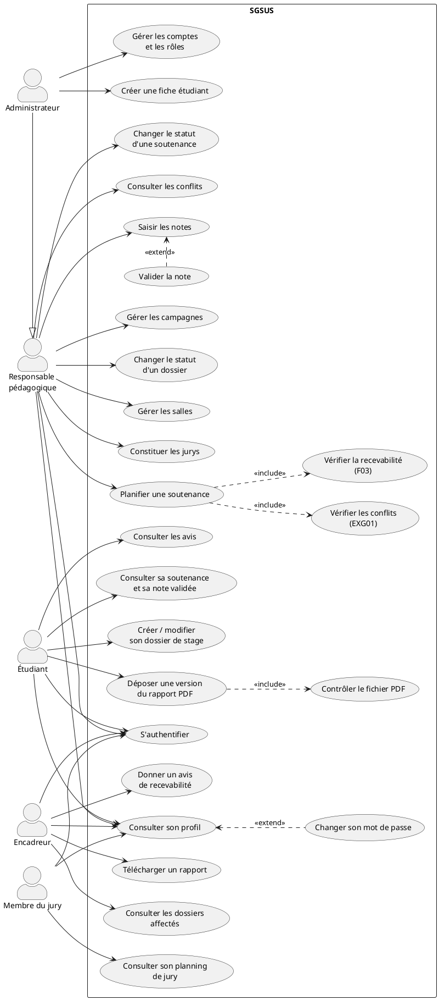

---

## 2. Diagramme de classes

**Objectif :** représenter les données métier et leurs relations (fichier
`backend/api/models.py`).

**Classes et attributs :**

| Classe | Attributs principaux |
|---|---|
| **User** (Django) | id, username, first_name, last_name, email, password (haché), is_active, is_staff, is_superuser |
| **Group** (Django) | id, name ∈ {admin, responsible, supervisor, student, jury} — représente le rôle |
| **Campaign** | id, academic_year : String, is_active : Boolean, created_at : DateTime |
| **Student** | id, student_number : String {unique}, full_name : String, email : String {unique} |
| **StudentAccount** | id — liaison 1:1 User ↔ Student |
| **InternshipFolder** | id, company_name : String, subject : Text, status : String, created_at : DateTime |
| **FolderSupervisor** | id — classe d'association Encadreur ↔ Dossier {unique (user, folder)} |
| **DocumentVersion** | id, version_number : Integer, file_path : String, uploaded_at : DateTime |
| **Review** | id, author_role : String, decision : String, comments : Text, created_at : DateTime |
| **Room** | id, name : String {unique}, capacity : Integer {> 0}, is_active : Boolean |
| **Jury** | id, name : String, is_complete : Boolean |
| **JuryMember** | id, member_name : String, role_in_jury ∈ {president, rapporteur, examinateur} |
| **JuryMemberAccount** | id — liaison 1:1 User ↔ JuryMember |
| **Defense** | id, room_name : String, slot_range : Intervalle[DateTime UTC], status : String |
| **Assessment** | id, report_grade : Decimal(5,2), oral_grade : Decimal(5,2), final_average : Decimal(5,2), is_approved : Boolean |

**Associations et multiplicités :**

- Campaign **1** —— **0..*** InternshipFolder
- Student **1** —— **0..*** InternshipFolder
- User **1** —— **0..1** StudentAccount **0..1** —— **1** Student
- InternshipFolder **1** —— **0..*** DocumentVersion (composition)
- DocumentVersion **1** —— **0..*** Review (composition)
- Review **0..*** —— **0..1** User (auteur)
- User (encadreur) **0..*** —— **0..*** InternshipFolder, via **FolderSupervisor**
- Jury **1** —— **0..*** JuryMember (composition)
- User **1** —— **0..1** JuryMemberAccount **0..1** —— **1** JuryMember
- InternshipFolder **1** —— **0..*** Defense
- Jury **0..1** —— **0..*** Defense
- Room **1** —— **0..*** Defense (lien logique par `room_name`)
- Defense **1** —— **0..1** Assessment (une seule évaluation par soutenance, règle de l'API)
- User **0..*** —— **0..*** Group (rôle)

**Contraintes à noter sur le diagramme :**
- {EXG01} une salle et un jury ne peuvent avoir deux soutenances dont les créneaux se chevauchent ;
- {0 ≤ note ≤ 20} sur les trois notes d'Assessment ;
- {un dossier n'est planifiable que s'il est « recevable » ou a un avis favorable} (F03).

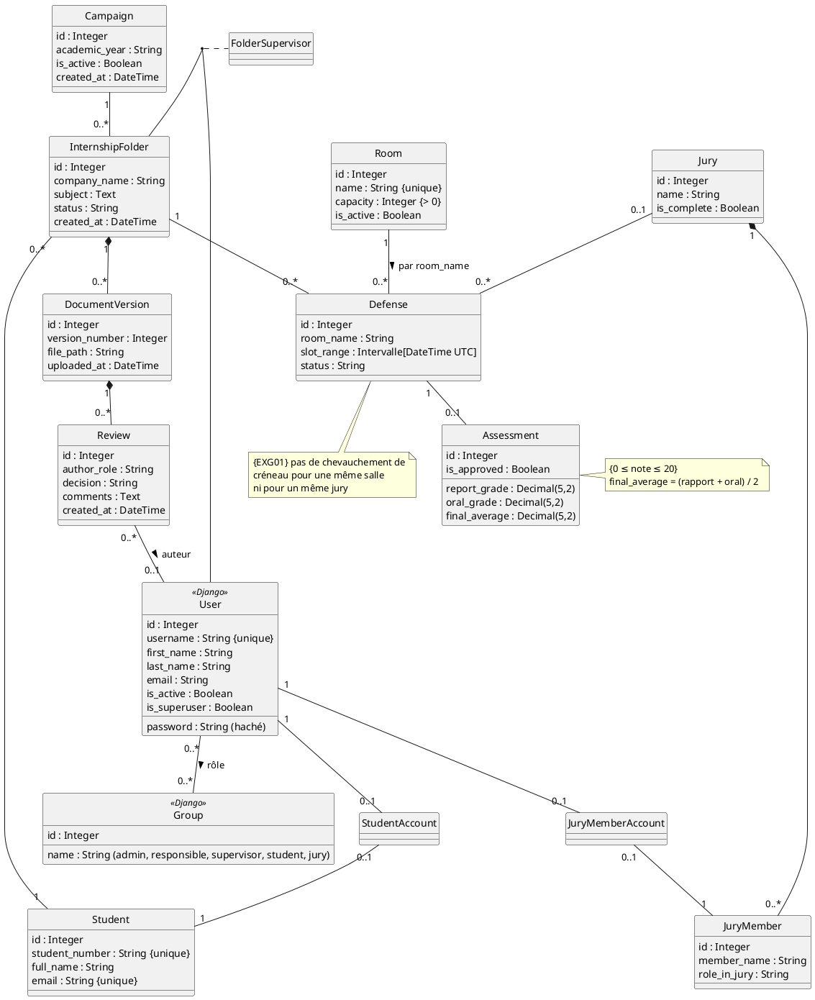

---

### 2.2 Classes ajoutées pour le socle du dossier ALM

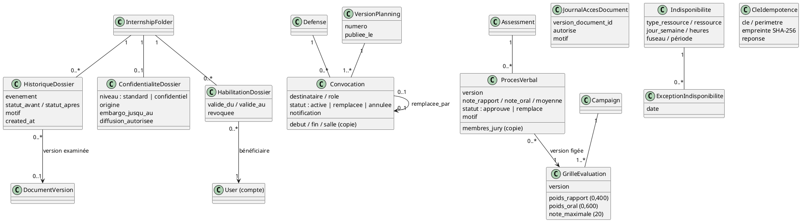

## 3. Modèle relationnel (MLD)

**Objectif :** traduire le diagramme de classes en tables PostgreSQL
(clés primaires soulignées, clés étrangères précédées de #).

```
campaign (id, academic_year, is_active, created_at)
student (id, student_number UNIQUE, full_name, email UNIQUE)
student_account (id, #user_id UNIQUE, #student_id UNIQUE)
internship_folder (id, #student_id, #campaign_id, company_name, subject, status, created_at)
folder_supervisor (id, #user_id, #folder_id)  UNIQUE(user_id, folder_id)
document_version (id, #folder_id, version_number, file_path, uploaded_at)
review (id, #document_version_id, #author_id, author_role, decision, comments, created_at)
room (id, name UNIQUE, capacity CHECK > 0, is_active)
jury (id, name, is_complete)
jury_member (id, #jury_id, member_name, role_in_jury)
jury_member_account (id, #user_id UNIQUE, #jury_member_id UNIQUE)
defense (id, #folder_id, #jury_id, room_name, slot_range TSTZRANGE, status)
    EXCLUDE (room_name WITH =, slot_range WITH &&)   -- EXG01 salle
    EXCLUDE (jury_id   WITH =, slot_range WITH &&)   -- EXG01 jury
assessment (id, #defense_id, report_grade, oral_grade, final_average, is_approved)
    CHECK 0 ≤ notes ≤ 20
auth_user, auth_group, auth_user_groups  -- tables Django des comptes et rôles
```

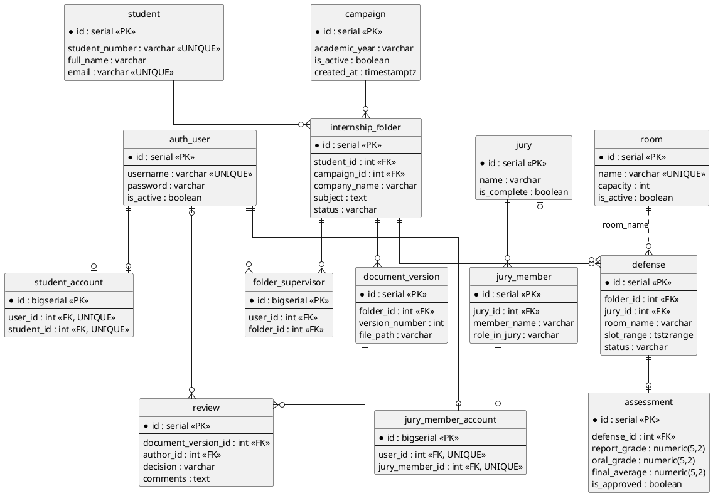

---

## 4. Diagrammes de séquence

### 4.1 Authentification (connexion JWT et renouvellement)

**Objectif :** montrer la connexion puis le renouvellement automatique du
jeton quand il expire (NFR02, NFR03).

**Participants :** Utilisateur, Application Flutter (`LoginScreen`,
`AuthProvider`, `ApiService`), API Django (`LoginView`, `TokenRefreshView`),
Base PostgreSQL.

**Scénario :**
1. L'utilisateur saisit identifiant et mot de passe.
2. Flutter envoie `POST /api/login/`.
3. Django vérifie le mot de passe (haché) et le rôle.
   - **alt** identifiants faux → `401` « Identifiant ou mot de passe incorrect » ;
   - **alt** aucun rôle → `403` ;
   - **sinon** → `200` avec `access`, `refresh` et le profil.
4. Flutter stocke les jetons (stockage sécurisé) et affiche le tableau de bord.
5. Plus tard, une requête reçoit `401` (jeton expiré) : `ApiService` appelle
   `POST /api/token/refresh/`, enregistre le nouveau jeton et **rejoue** la
   requête une seule fois.

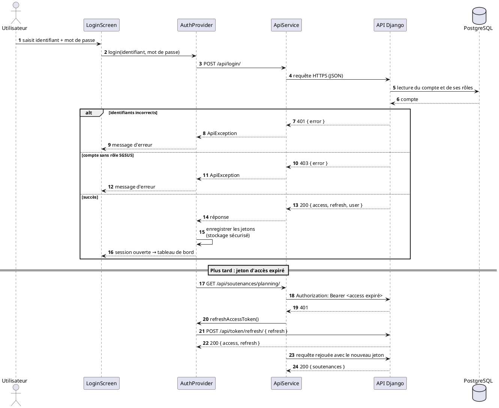

### 4.2 Planification d'une soutenance (contrôle EXG01)

**Objectif :** montrer la double protection contre les conflits : contrôle
applicatif (message lisible) puis contrainte PostgreSQL (concurrence).

**Participants :** Responsable, `DefenseFormScreen`, `PlanningService`,
API Django (`DefenseViewSet`, `DefenseSerializer`), service `conflicts`,
PostgreSQL.

**Scénario :**
1. Le responsable choisit dossier, jury, salle, date et horaires.
2. Flutter affiche les conflits *probables* détectés localement (aide).
3. `POST /api/soutenances/` est envoyé.
4. Le sérialiseur appelle `conflicts.verifier_toutes_regles` : dossier
   recevable (F03), salle active, jury non vide, pas de chevauchement (EXG01).
   - **alt** règle violée → `400` avec un message explicite.
5. Insertion en base ; si une autre requête a réservé le même créneau entre-temps,
   la **contrainte d'exclusion** PostgreSQL rejette l'insertion → `400` « Conflit
   de réservation (EXG01) ».
6. Sinon → `201`, le planning partagé est rechargé.

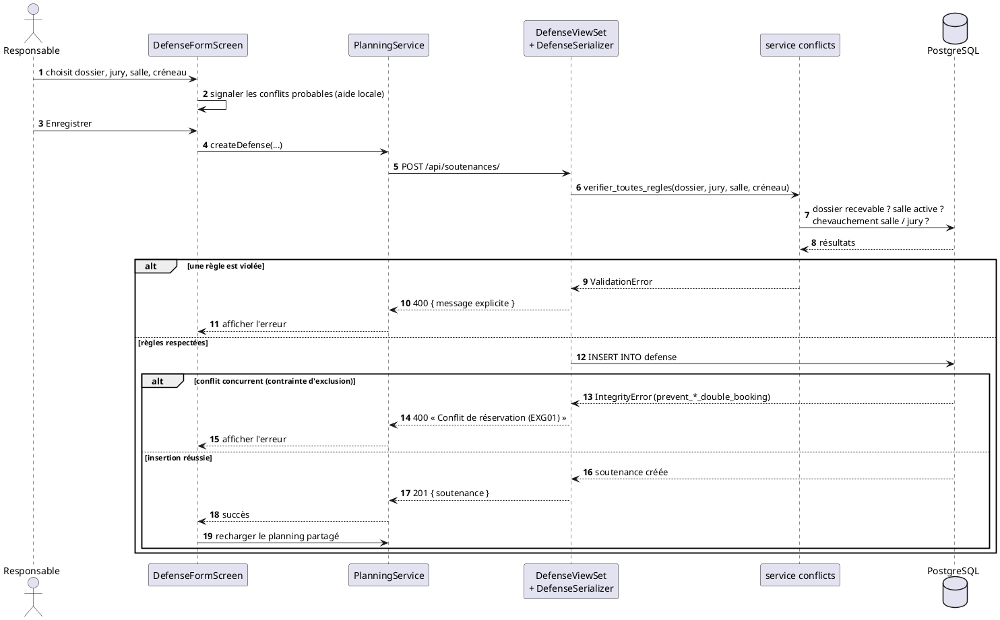

### 4.3 Dépôt d'un rapport PDF

**Objectif :** montrer la validation du fichier et le versionnement
transactionnel (F02, NFR03).

**Scénario :**
1. L'étudiant choisit un fichier PDF ; Flutter vérifie la taille (≤ 10 Mo).
2. `POST /api/documents/upload/` (multipart : `folder_id`, `file`).
3. Django vérifie le rôle et que le dossier appartient à l'étudiant (sinon `403`).
4. `validate_pdf_file` : taille, extension `.pdf`, signature `%PDF-` (sinon `400`).
5. Transaction : verrou du dossier (`SELECT … FOR UPDATE`), calcul du numéro
   de version suivant, enregistrement du fichier sous un nom aléatoire,
   création de la ligne `document_version` → `201`.

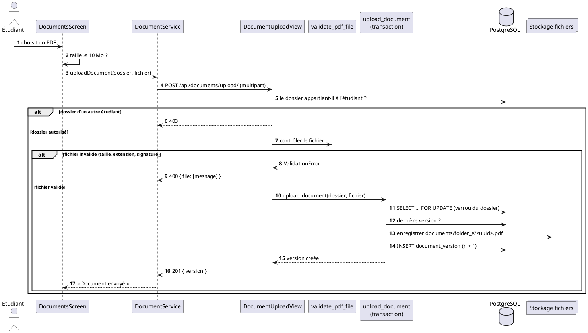

### 4.4 Évaluation d'une soutenance

**Objectif :** montrer la saisie des notes, le calcul de la moyenne en
Decimal (F06, NFR04) et la consultation de la note validée par l'étudiant.

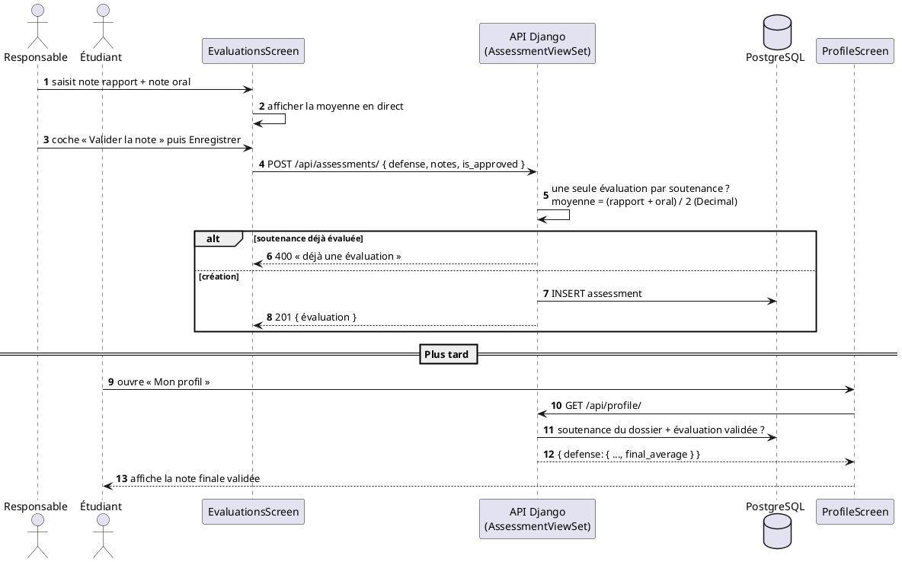

---

### 4.5 Publication du planning (F05, EXG01, idempotence)

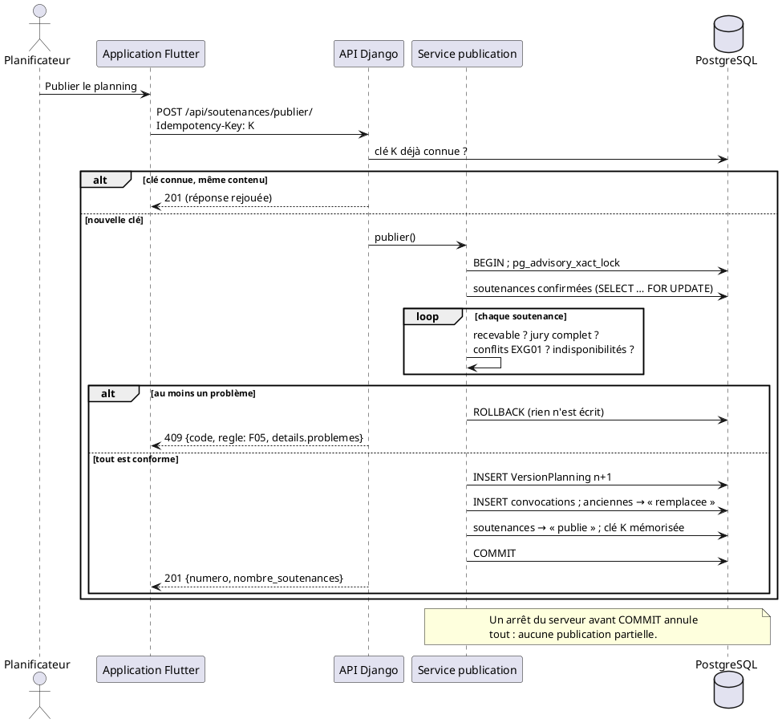

## 5. Diagrammes d'activité

### 5.1 Parcours complet d'un stage (de la création du dossier à la note)

**Objectif :** vue d'ensemble du processus métier, avec les couloirs
(« swimlanes ») des acteurs.

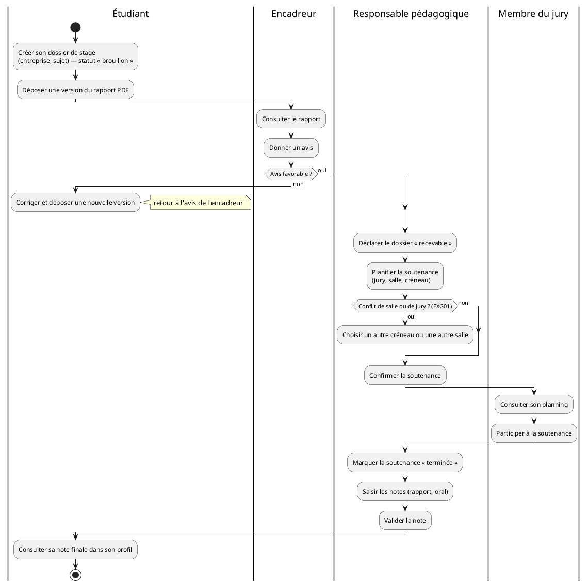

### 5.2 Algorithme de vérification d'une réservation (EXG01 et F03)

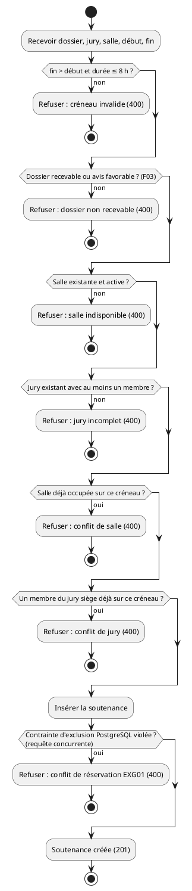

---

## 6. Diagrammes d'états-transitions

### 6.1 Dossier de stage (`InternshipFolder.status`)

Le statut ne change QUE par ces événements (`backend/api/services/dossiers.py`) ; l'API refuse une
étape sautée (409 STA11) et chaque transition est enregistrée dans `HistoriqueDossier`.

| Événement | Acteur | Départ → arrivée | Précondition |
|---|---|---|---|
| soumettre | Étudiant propriétaire | brouillon, a_corriger → soumis | ≥ 1 version du rapport |
| avis pédagogique | Encadreur affecté | soumis → valide (favorable) / a_corriger (défavorable) | avis sur la dernière version |
| autoriser la soutenance | Responsable | valide → recevable | avis favorable sur la dernière version |
| refuser | Responsable | soumis, a_corriger, valide → rejete | motif |
| rouvrir | Responsable | rejete, recevable → soumis | motif, aucune soutenance active |
| nouvelle version | Étudiant (dépôt) | valide, recevable → soumis | recevabilité réexaminée (STA05) |

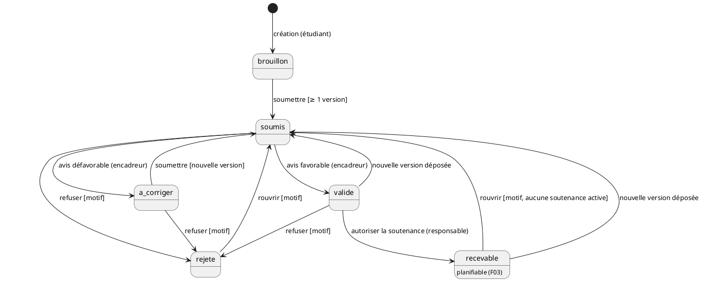

### 6.2 Soutenance (`Defense.status`)

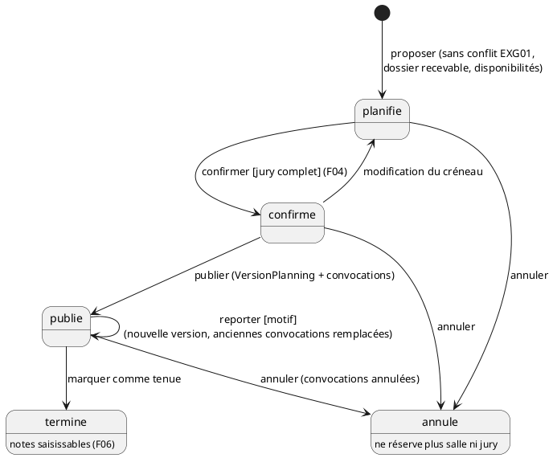

### 6.3 Résultat (`Assessment` et `ProcesVerbal`)

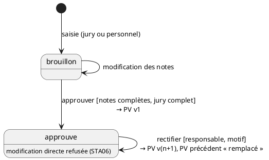

---

## 7. Diagramme de composants (architecture logicielle)

**Objectif :** montrer les grandes briques logicielles et leurs dépendances.

- **Client Flutter** : `screens` (écrans) → `widgets` (composants réutilisables)
  → `providers` (état : session, planning) → `services` (un par domaine) →
  `core/network/ApiService` (client HTTP unique : JWT, renouvellement, erreurs).
- **API Django REST** : `middleware` (sonde /health/, CORS, sécurité) →
  `urls` → `views` (par domaine) → `serializers` → `services` (règles métier
  `conflicts`, `sante`) → `models` (ORM).
- **PostgreSQL 17** : tables, contraintes d'exclusion EXG01, contraintes CHECK.
- **Interface fournie** par l'API : *API REST JSON + JWT* ; **interface requise**
  par Flutter : la même.

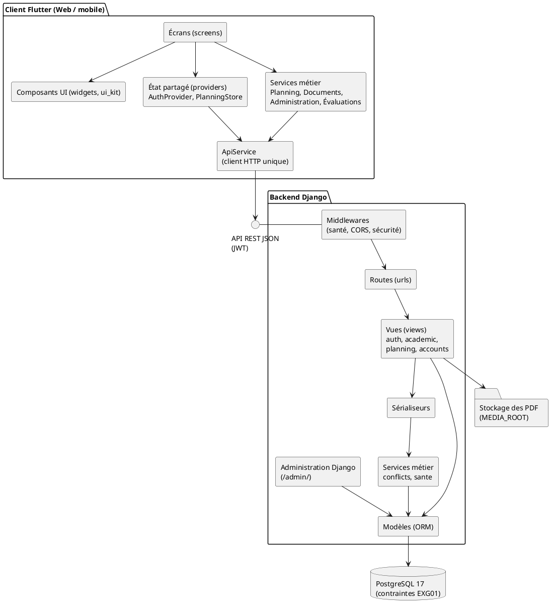

---

## 8. Diagramme de déploiement

**Objectif :** montrer où s'exécute chaque partie en production (Render).

- **Poste utilisateur** : navigateur web (ou mobile) qui charge l'application
  Flutter.
- **Render — Static Site** `gestion-stage-soutenance-frontend` : fichiers
  Flutter Web compilés (HTML, JS, polices).
- **Render — Web Service** `gestion-stage-soutenance` : conteneur Docker
  (`backend/Dockerfile`) ; au démarrage, `entrypoint.sh` attend la base,
  applique les migrations, collecte les statiques puis lance **Gunicorn**
  (Django + WhiteNoise). Sonde de santé : `/health/`.
- **Render — PostgreSQL 17** : base de données (accès interne depuis le
  Web Service, accès externe pour pgAdmin).
- **GitHub** : dépôt du code ; **GitHub Actions** (CI) teste Flutter et Django
  et construit l'image Docker ; chaque push sur `main` déclenche le
  redéploiement automatique sur Render.
- **Protocoles** : HTTPS entre navigateur, site et API ; TLS PostgreSQL
  (sslmode=require) entre l'API et la base.

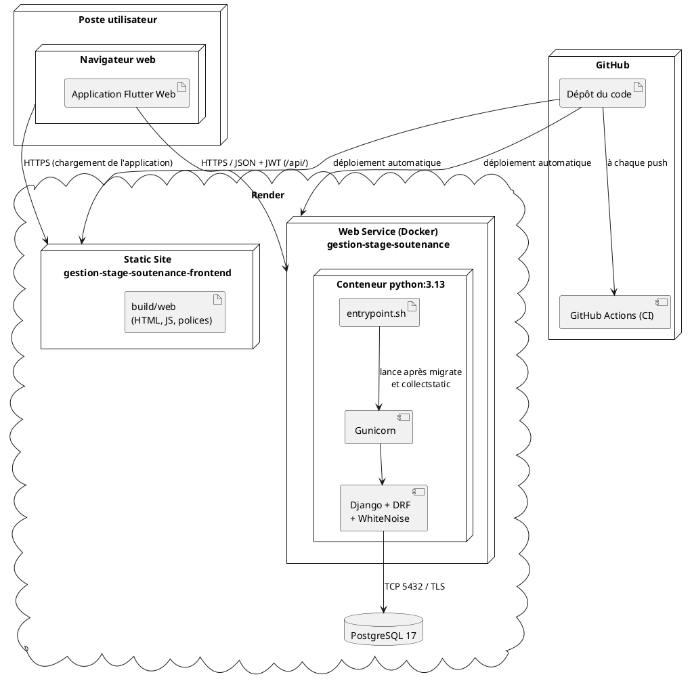

---

## 9. Diagramme de paquetages

**Objectif :** montrer l'organisation des dossiers du code et leurs
dépendances (couches).

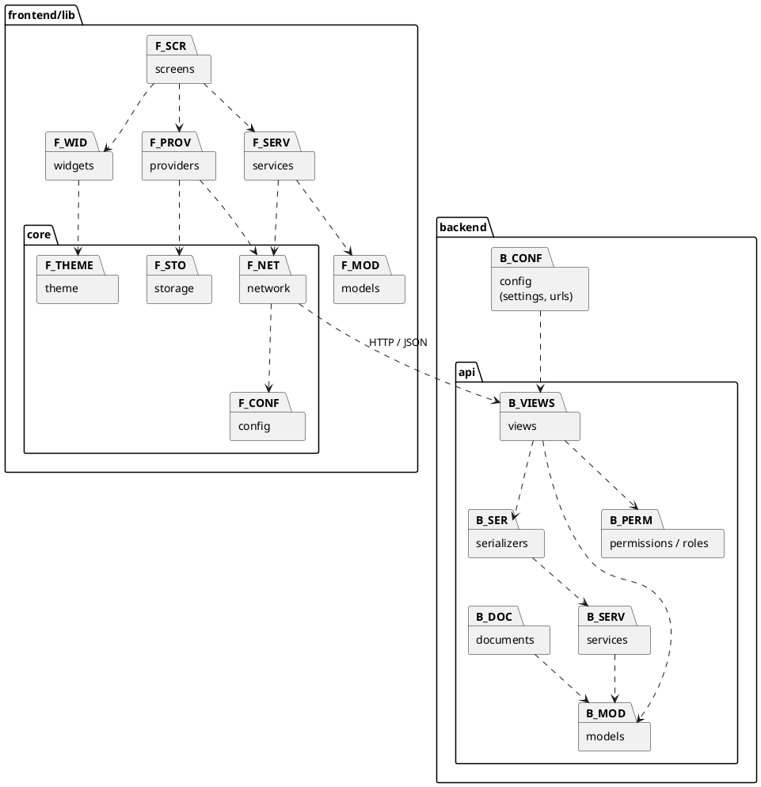

---

## Récapitulatif

| N° | Diagramme | Type UML | Montre |
|---|---|---|---|
| 1 | Cas d'utilisation | Comportement | Acteurs et fonctionnalités (F01–F06) |
| 2 | Classes | Structure | Données métier, relations, contraintes |
| 3 | Modèle relationnel | Données | Tables PostgreSQL, clés, contraintes EXG01 |
| 4.1 | Séquence — authentification | Interaction | Connexion JWT et renouvellement |
| 4.2 | Séquence — planification | Interaction | Double contrôle des conflits EXG01 |
| 4.3 | Séquence — dépôt PDF | Interaction | Validation et versionnement |
| 4.4 | Séquence — évaluation | Interaction | Notes, moyenne Decimal, consultation |
| 5.1 | Activité — parcours | Comportement | Processus complet du stage |
| 5.2 | Activité — vérification | Comportement | Algorithme des règles de planification |
| 6.1 | États — dossier | Comportement | Cycle de vie du dossier |
| 6.2 | États — soutenance | Comportement | Cycle de vie de la soutenance |
| 7 | Composants | Structure | Architecture logicielle Flutter / Django |
| 8 | Déploiement | Structure | Infrastructure Render et GitHub |
| 9 | Paquetages | Structure | Organisation du code en couches |
